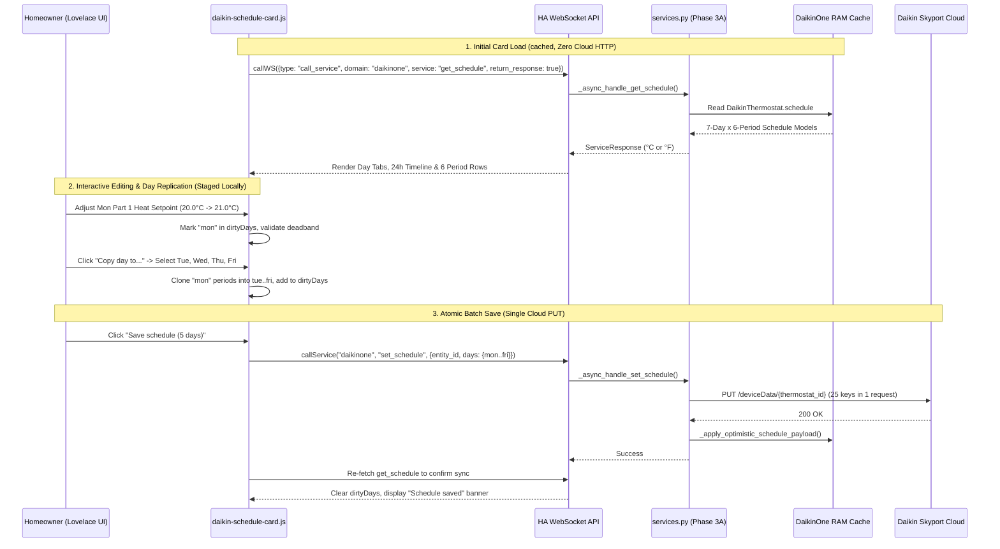

# Native 7-Day Visual Lovelace Schedule Card Architecture

**Document ID:** `19_seven_day_schedule_lovelace_card_design`  
**Date:** October 22, 2026  
**Status:** Approved Technical Design  
**Phase:** Phase 3B (Native 7-Day Visual Lovelace Schedule Card)  
**Target Artifact:** `/config/www/daikin-schedule-card.js` (Custom Web Component `daikin-schedule-card`)  
**Backend Dependency:** [`18_cloud_schedule_service_layer_design.md`](file:///workspace/daikin_design_docs/18_cloud_schedule_service_layer_design.md) (Phase 3A: `daikinone.get_schedule` & `daikinone.set_schedule`)  
**Related Documents:**  
* [`03_feature_roadmap_and_backlog.md`](file:///workspace/daikin_design_docs/03_feature_roadmap_and_backlog.md) (Phase 3A & Phase 3B Roadmap Entries)  
* [`02_hybrid_scheduling_design.md`](file:///workspace/daikin_design_docs/02_hybrid_scheduling_design.md) (Hybrid HVAC Scheduling Architecture)  

---

## 1. Executive Summary & Core UX Philosophy

This specification defines the complete frontend architecture, state machine, user interface layout, WebSocket communication contract, and production Web Component implementation for **Phase 3B: Native 7-Day Visual Lovelace Schedule Card** (`daikin-schedule-card.js`).

### 1.1 Bridging Physical Hardware and Home Assistant Dashboards
While Home Assistant provides basic time helpers (`schedule.*`), those helpers operate strictly inside Home Assistant and cannot read or program the internal 7-day $\times$ 6-period non-volatile schedule stored inside the physical `Daikin One+` wall thermostat and Daikin Skyport Cloud.

As established in the [Hybrid HVAC Scheduling Architecture](file:///workspace/daikin_design_docs/02_hybrid_scheduling_design.md), maintaining a well-tuned baseline schedule directly on the Daikin thermostat hardware guarantees 100% fail-safe autonomous heating and cooling if Home Assistant is ever offline, rebooting, or disconnected from Wi-Fi.

The `daikin-schedule-card` provides a zero-dependency native Web Component (`HTMLElement` with Shadow DOM) that connects directly to the Phase 3A backend service layer ([`custom_components/daikinone/services.py`](file:///workspace/ha-daikinone/custom_components/daikinone/services.py)):
1. **True 7-Day Tabbed Navigation (`Mon`–`Sun`):** Mirrors the physical `Daikin One+` touchscreen and `SkyportHome` mobile app, allowing independent inspection and editing of all seven days of the week (`mon`, `tue`, `wed`, `thu`, `fri`, `sat`, `sun`).
2. **24-Hour Proportional Visual Timeline Bar:** Renders a color-coded 24-hour horizontal bar at the top of the selected day, displaying proportional time blocks for active periods (`Wake`, `Afternoon`, `Dinner`, `Evening`, `Sleep`, `Night`) with dual heat/cool setpoints.
3. **6-Period Interactive Editor Rows:** Displays all 6 daily schedule slots (`Part 1` to `Part 6`) with an enable/disable toggle switch, editable period label, 15-minute increment time selector (`00:00` to `23:45`), and dual `[ - ]` / `[ + ]` stepper controls for Heating (`heat_target`) and Cooling (`cool_target`) setpoints.
4. **"Copy Day To..." Multi-Day Replication Modal (Option 1):** Eliminates tedious repetition when programming weekdays or weekends. Clicking **Copy day to...** opens an inline multi-select modal with quick-select presets (**Weekdays Mon–Fri**, **Weekend Sat–Sun**, **All Days**) and individual day checkboxes. Applying the copy clones the active day's 6 periods into the selected target days in local staging state and marks those days as modified (`dirty`) prior to a single atomic batch save.
5. **Single Atomic Batch Save (`daikinone.set_schedule`):** Tracks unsaved modifications per day (`dirtyDays: Set<string>`). Clicking **Save schedule** dispatches one WebSocket service call containing only the modified days, updating up to 42 periods in a single HTTP `PUT /deviceData/{id}` transaction.



---

## 2. User Interface Layout & Visual Hierarchy

```
┌──────────────────────────────────────────────────────────────────────────────┐
│  MainFloor Schedule                               [Following Schedule]  [↻]  │
│  climate.mainfloor_thermostat                     Schedule Enabled: [●───]   │
├──────────────────────────────────────────────────────────────────────────────┤
│  [ Mon* ]  [ Tue* ]  [ Wed* ]  [ Thu* ]  [ Fri* ]  [ Sat ]  [ Sun ]          │
├──────────────────────────────────────────────────────────────────────────────┤
│  24-Hour Timeline (Monday)                                                   │
│  ┌──────────────┬───────────────────┬──────────────────────────┬──────────┐  │
│  │ 00:00–06:00  │ 06:00–12:45       │ 12:45–21:00              │ 21:00+   │  │
│  │ 17.5° / 24°  │ Wake: 20° / 24°   │ Afternoon: 20° / 24°     │ 18° / 24°│  │
│  └──────────────┴───────────────────┴──────────────────────────┴──────────┘  │
│  00:00        06:00               12:00                      18:00     24:00 │
├──────────────────────────────────────────────────────────────────────────────┤
│  [●] Part 1  [ wake      ]  [ 06:00 ▾ ]   Heat: [-] 20.0°C [+]  Cool: [-] 24.0°C [+] │
│  [●] Part 2  [ afternoon ]  [ 12:45 ▾ ]   Heat: [-] 20.0°C [+]  Cool: [-] 24.0°C [+] │
│  [●] Part 3  [ sleep     ]  [ 21:00 ▾ ]   Heat: [-] 18.0°C [+]  Cool: [-] 24.0°C [+] │
│  [●] Part 4  [ night     ]  [ 23:45 ▾ ]   Heat: [-] 17.5°C [+]  Cool: [-] 24.0°C [+] │
│  [○] Part 5  [ —         ]  [ 00:00 ▾ ]   (Disabled)                         │
│  [○] Part 6  [ —         ]  [ 00:00 ▾ ]   (Disabled)                         │
├──────────────────────────────────────────────────────────────────────────────┤
│  [ Copy Monday to... ]                     [ Discard ]  [ Save (5 days) ]    │
└──────────────────────────────────────────────────────────────────────────────┘
```

### 2.1 Component Sections

1. **Card Header & Status Bar:**
   - **Title & Subtitle:** Displays configured card title (or thermostat name) and `entity_id`.
   - **Live Status Badge:**
     - `Following schedule` (green badge) when `schedule_enabled == true` and `schedule_override == false`.
     - `Temporary hold` (amber badge + quick **Resume** button calling `button.press` or `set_schedule`) when `schedule_override == true`.
     - `Schedule disabled` (gray badge) when `schedule_enabled == false`.
   - **Master Schedule Switch & Refresh Button:** Quick toggle for `schedule_enabled` and a manual refresh icon button `[↻]` to re-pull `daikinone.get_schedule`.

2. **7-Day Tab Bar (`Mon` through `Sun`):**
   - Horizontal pill bar with 7 tabs (`Mon`, `Tue`, `Wed`, `Thu`, `Fri`, `Sat`, `Sun`).
   - Automatically defaults to the current day of the week on initial open.
   - Displays an amber dot indicator (`•`) on any tab with unsaved local edits (`dirtyDays.has(dayKey)`).

3. **24-Hour Proportional Timeline Bar:**
   - Visualizes how the enabled periods partition the 24-hour day (`96` 15-minute slots).
   - Sorts enabled periods by `start_slot`. If the first enabled period starts after `00:00` (e.g., `06:00` / slot `24`), renders an initial carry-over segment from `00:00` to `06:00` reflecting the previous night's last active setpoint.
   - Each segment width is proportional to `(next_slot - current_slot) / 96 * 100%`.

4. **6-Period Schedule Editor List (`Part 1` to `Part 6`):**
   - Renders all 6 hardware slots in order (`part: 1..6`).
   - **Enable Toggle:** Checkbox/switch toggling `period.enabled`. When `enabled == false`, time and temperature controls are visually muted (`opacity: 0.45`) and non-interactive until enabled.
   - **Label Input:** Compact text input (max 16 chars) for period name (e.g. `wake`, `away`, `home`, `sleep`), with placeholder `Period N`.
   - **15-Minute Time Selector:** `<select>` dropdown populated with all 96 15-minute slots (`00:00`, `00:15`, `00:30`, ..., `23:45`), displaying both 24-hour and 12-hour AM/PM labels.
   - **Dual Setpoint Steppers (`Heat` & `Cool`):**
     - Step size: `0.5°C` when `temperature_unit == "°C"` or `1.0°F` (or `0.5°F`) when `temperature_unit == "°F"`.
     - Enforces hardware bounds (`min_temp` to `max_temp`) and minimum deadband (`min_temp_delta`):
       - If the user increments `heat_target` such that `cool_target - heat_target < min_temp_delta`, the card automatically pushes `cool_target` up to `heat_target + min_temp_delta` (capped at `max_temp`), matching the physical `Daikin One+` wall touchscreen behavior!
       - Conversely, if the user decrements `cool_target` within `min_temp_delta` of `heat_target`, `heat_target` automatically adjusts down to `cool_target - min_temp_delta`.

5. **"Copy Day To..." Modal (Option 1):**
   - Clicking **Copy `<Day>` to...** opens an overlay dialog inside the card:
     - **Quick Preset Buttons:**
       - `Weekdays (Mon–Fri)`
       - `Weekend (Sat–Sun)`
       - `All days`
       - `Clear`
     - **Individual Day Checkboxes:** `Mon`, `Tue`, `Wed`, `Thu`, `Fri`, `Sat`, `Sun` (with the source day disabled/checked).
     - **Apply Copy Button:** Deep-copies all 6 periods from the active day into each selected target day in local staging memory, adds each target day to `dirtyDays`, and closes the modal.

6. **Action Footer Bar:**
   - **Copy `<Day>` to...** button on the left.
   - **Discard** button (resets local staging copy back to `originalSchedule` and clears `dirtyDays`) and **Save schedule (`N` days)** primary button on the right (enabled only when `dirtyDays.size > 0` or `scheduleEnabledDirty`).

---

## 3. WebSocket & Service Contract

### 3.1 Fetching Schedule Data (`daikinone.get_schedule`)
In Home Assistant Lovelace custom cards, services registered with `SupportsResponse.ONLY` are invoked via `hass.callWS`:

```javascript
const response = await this._hass.callWS({
  type: "call_service",
  domain: this._domain, // "daikinone" (or configurable domain e.g. "daikin_skyport_home")
  service: "get_schedule",
  service_data: {
    entity_id: this._config.entity,
  },
  return_response: true,
});
const scheduleData = response.response;
```

### 3.2 Saving Modified Days (`daikinone.set_schedule`)
When the user clicks **Save schedule**, the card constructs a payload containing only the modified days (`this._dirtyDays`) and calls `hass.callService`:

```javascript
const daysPayload = {};
for (const dayKey of this._dirtyDays) {
  daysPayload[dayKey] = this._workingSchedule.days[dayKey].map((p) => ({
    part: p.part,
    enabled: p.enabled,
    start_time: p.start_time,
    heat_target: p.heat_target,
    cool_target: p.cool_target,
    label: p.label || "",
  }));
}

const serviceData = {
  entity_id: this._config.entity,
  temperature_unit: this._workingSchedule.temperature_unit,
};
if (Object.keys(daysPayload).length > 0) {
  serviceData.days = daysPayload;
}
if (this._scheduleEnabledDirty) {
  serviceData.schedule_enabled = this._workingSchedule.schedule_enabled;
}

await this._hass.callService(this._domain, "set_schedule", serviceData);
```

---

## 4. Complete Production Implementation (`daikin-schedule-card.js`)

Below is the complete, self-contained, zero-dependency ES6 Web Component implementation ready to be placed at `/config/www/daikin-schedule-card.js` and registered as a Lovelace module resource (`/local/daikin-schedule-card.js`).

```javascript
/**
 * Daikin One+ 7-Day Visual Schedule Lovelace Card (Phase 3B)
 * Connects to daikinone.get_schedule and daikinone.set_schedule (Phase 3A).
 */

const DAY_KEYS = ["mon", "tue", "wed", "thu", "fri", "sat", "sun"];
const DAY_LABELS = {
  mon: { short: "Mon", full: "Monday" },
  tue: { short: "Tue", full: "Tuesday" },
  wed: { short: "Wed", full: "Wednesday" },
  thu: { short: "Thu", full: "Thursday" },
  fri: { short: "Fri", full: "Friday" },
  sat: { short: "Sat", full: "Saturday" },
  sun: { short: "Sun", full: "Sunday" },
};

const PERIOD_COLORS = [
  "#f59e0b", // Part 1 (Wake - Amber)
  "#3b82f6", // Part 2 (Day/Away - Blue)
  "#10b981", // Part 3 (Afternoon/Home - Emerald)
  "#8b5cf6", // Part 4 (Dinner/Evening - Violet)
  "#6366f1", // Part 5 (Sleep - Indigo)
  "#334155", // Part 6 (Night - Slate)
];

function buildTimeOptions() {
  const options = [];
  for (let slot = 0; slot < 96; slot++) {
    const totalMinutes = slot * 15;
    const h24 = Math.floor(totalMinutes / 60);
    const min = totalMinutes % 60;
    const value = `${String(h24).padStart(2, "0")}:${String(min).padStart(2, "0")}`;
    const period = h24 >= 12 ? "PM" : "AM";
    const h12 = h24 % 12 === 0 ? 12 : h24 % 12;
    const label = `${value} (${h12}:${String(min).padStart(2, "0")} ${period})`;
    options.push({ slot, value, label });
  }
  return options;
}

const TIME_OPTIONS = buildTimeOptions();

function timeStrToSlot(timeStr) {
  const [h, m] = (timeStr || "00:00").split(":").map((n) => parseInt(n, 10) || 0);
  return Math.max(0, Math.min(95, Math.floor((h * 60 + m) / 15)));
}

class DaikinScheduleCard extends HTMLElement {
  constructor() {
    super();
    this.attachShadow({ mode: "open" });
    this._hass = null;
    this._config = null;
    this._domain = "daikinone";
    this._originalSchedule = null;
    this._workingSchedule = null;
    this._selectedDay = this._getCurrentDayKey();
    this._dirtyDays = new Set();
    this._scheduleEnabledDirty = false;
    this._loading = false;
    this._saving = false;
    this._error = null;
    this._statusMessage = null;
    this._copyModalOpen = false;
    this._copyTargets = new Set();
    this._initialized = false;
  }

  _getCurrentDayKey() {
    const jsDay = new Date().getDay(); // 0=Sun, 1=Mon, ..., 6=Sat
    return DAY_KEYS[(jsDay + 6) % 7];
  }

  setConfig(config) {
    if (!config.entity || !config.entity.startsWith("climate.")) {
      throw new Error("Please specify a valid Daikin climate entity (e.g. climate.mainfloor_thermostat).");
    }
    this._config = config;
    this._domain = config.domain || "daikinone";
    this._initialized = false;
    this._render();
  }

  set hass(hass) {
    this._hass = hass;
    if (!this._initialized && this._config && this._hass) {
      this._initialized = true;
      this._fetchSchedule();
    }
  }

  getCardSize() {
    return 7;
  }

  async _fetchSchedule() {
    if (!this._hass || !this._config) return;
    this._loading = true;
    this._error = null;
    this._statusMessage = null;
    this._render();

    try {
      const res = await this._hass.callWS({
        type: "call_service",
        domain: this._domain,
        service: "get_schedule",
        service_data: {
          entity_id: this._config.entity,
        },
        return_response: true,
      });

      const data = res.response;
      this._originalSchedule = JSON.parse(JSON.stringify(data));
      this._workingSchedule = JSON.parse(JSON.stringify(data));
      this._dirtyDays.clear();
      this._scheduleEnabledDirty = false;
    } catch (err) {
      this._error = err?.message || "Failed to load thermostat schedule.";
    } finally {
      this._loading = false;
      this._render();
    }
  }

  async _saveSchedule() {
    if (!this._hass || !this._workingSchedule || this._saving) return;
    if (this._dirtyDays.size === 0 && !this._scheduleEnabledDirty) return;

    this._saving = true;
    this._error = null;
    this._statusMessage = null;
    this._render();

    try {
      const daysPayload = {};
      for (const dayKey of this._dirtyDays) {
        daysPayload[dayKey] = this._workingSchedule.days[dayKey].map((p) => ({
          part: p.part,
          enabled: Boolean(p.enabled),
          start_time: p.start_time,
          heat_target: Number(p.heat_target),
          cool_target: Number(p.cool_target),
          label: String(p.label || "").trim(),
        }));
      }

      const serviceData = {
        entity_id: this._config.entity,
        temperature_unit: this._workingSchedule.temperature_unit,
      };
      if (Object.keys(daysPayload).length > 0) {
        serviceData.days = daysPayload;
      }
      if (this._scheduleEnabledDirty) {
        serviceData.schedule_enabled = Boolean(this._workingSchedule.schedule_enabled);
      }

      await this._hass.callService(this._domain, "set_schedule", serviceData);

      const savedCount = this._dirtyDays.size;
      await this._fetchSchedule();
      this._statusMessage =
        savedCount > 0
          ? `Saved schedule changes across ${savedCount} day${savedCount > 1 ? "s" : ""}.`
          : "Updated schedule status.";
    } catch (err) {
      this._error = err?.message || "Failed to save schedule changes.";
    } finally {
      this._saving = false;
      this._render();
    }
  }

  _discardChanges() {
    if (!this._originalSchedule) return;
    this._workingSchedule = JSON.parse(JSON.stringify(this._originalSchedule));
    this._dirtyDays.clear();
    this._scheduleEnabledDirty = false;
    this._error = null;
    this._statusMessage = null;
    this._render();
  }

  _toggleMasterScheduleEnabled() {
    if (!this._workingSchedule) return;
    this._workingSchedule.schedule_enabled = !this._workingSchedule.schedule_enabled;
    this._scheduleEnabledDirty =
      this._workingSchedule.schedule_enabled !== this._originalSchedule.schedule_enabled;
    this._render();
  }

  _updatePeriodField(dayKey, partIndex, field, value) {
    const period = this._workingSchedule.days[dayKey][partIndex];
    if (!period) return;

    const minTemp = this._workingSchedule.min_temp ?? 10.0;
    const maxTemp = this._workingSchedule.max_temp ?? 32.0;
    const minDelta = this._workingSchedule.min_temp_delta ?? 2.0;

    if (field === "enabled") {
      period.enabled = Boolean(value);
    } else if (field === "label") {
      period.label = String(value).slice(0, 16);
    } else if (field === "start_time") {
      period.start_time = value;
      period.start_slot = timeStrToSlot(value);
    } else if (field === "heat_target") {
      let newHeat = Math.max(minTemp, Math.min(maxTemp - minDelta, Number(value.toFixed(1))));
      period.heat_target = newHeat;
      if (period.cool_target - newHeat < minDelta) {
        period.cool_target = Number(Math.min(maxTemp, newHeat + minDelta).toFixed(1));
      }
    } else if (field === "cool_target") {
      let newCool = Math.max(minTemp + minDelta, Math.min(maxTemp, Number(value.toFixed(1))));
      period.cool_target = newCool;
      if (newCool - period.heat_target < minDelta) {
        period.heat_target = Number(Math.max(minTemp, newCool - minDelta).toFixed(1));
      }
    }

    this._dirtyDays.add(dayKey);
    this._statusMessage = null;
    this._render();
  }

  _openCopyModal() {
    this._copyTargets = new Set();
    this._copyModalOpen = true;
    this._render();
  }

  _closeCopyModal() {
    this._copyModalOpen = false;
    this._copyTargets.clear();
    this._render();
  }

  _selectCopyPreset(preset) {
    this._copyTargets.clear();
    if (preset === "weekdays") {
      ["mon", "tue", "wed", "thu", "fri"].forEach((d) => {
        if (d !== this._selectedDay) this._copyTargets.add(d);
      });
    } else if (preset === "weekend") {
      ["sat", "sun"].forEach((d) => {
        if (d !== this._selectedDay) this._copyTargets.add(d);
      });
    } else if (preset === "all") {
      DAY_KEYS.forEach((d) => {
        if (d !== this._selectedDay) this._copyTargets.add(d);
      });
    }
    this._render();
  }

  _toggleCopyTarget(dayKey) {
    if (dayKey === this._selectedDay) return;
    if (this._copyTargets.has(dayKey)) {
      this._copyTargets.delete(dayKey);
    } else {
      this._copyTargets.add(dayKey);
    }
    this._render();
  }

  _applyCopyDay() {
    if (!this._workingSchedule || this._copyTargets.size === 0) return;
    const sourcePeriods = this._workingSchedule.days[this._selectedDay];
    for (const targetDay of this._copyTargets) {
      this._workingSchedule.days[targetDay] = JSON.parse(JSON.stringify(sourcePeriods));
      this._dirtyDays.add(targetDay);
    }
    const count = this._copyTargets.size;
    const sourceName = DAY_LABELS[this._selectedDay].full;
    this._copyModalOpen = false;
    this._copyTargets.clear();
    this._statusMessage = `Copied ${sourceName} schedule to ${count} day${count > 1 ? "s" : ""}. Click Save schedule to apply.`;
    this._render();
  }

  _buildTimelineSegments(dayKey) {
    const periods = (this._workingSchedule?.days?.[dayKey] || [])
      .map((p, idx) => ({ ...p, color: PERIOD_COLORS[idx % PERIOD_COLORS.length] }))
      .filter((p) => p.enabled)
      .sort((a, b) => a.start_slot - b.start_slot);

    if (periods.length === 0) {
      return [
        {
          widthPct: 100,
          color: "#475569",
          label: "No active periods enabled for this day",
          sublabel: "",
        },
      ];
    }

    const segments = [];
    const unit = this._workingSchedule.temperature_unit || "°C";

    if (periods[0].start_slot > 0) {
      const carry = periods[periods.length - 1];
      segments.push({
        widthPct: (periods[0].start_slot / 96) * 100,
        color: "#334155",
        label: "00:00",
        sublabel: `${carry.heat_target}${unit} / ${carry.cool_target}${unit}`,
      });
    }

    for (let i = 0; i < periods.length; i++) {
      const current = periods[i];
      const nextSlot = i + 1 < periods.length ? periods[i + 1].start_slot : 96;
      const span = Math.max(1, nextSlot - current.start_slot);
      segments.push({
        widthPct: (span / 96) * 100,
        color: current.color,
        label: `${current.label || `P${current.part}`} (${current.start_time})`,
        sublabel: `${current.heat_target}${unit} / ${current.cool_target}${unit}`,
      });
    }

    return segments;
  }

  _render() {
    if (!this.shadowRoot) return;

    const title =
      this._config?.title ||
      (this._workingSchedule?.name ? `${this._workingSchedule.name} schedule` : "Thermostat schedule");
    const unit = this._workingSchedule?.temperature_unit || "°C";
    const step = unit === "°F" ? 1.0 : 0.5;
    const hasUnsaved = this._dirtyDays.size > 0 || this._scheduleEnabledDirty;

    const dayPeriods = this._workingSchedule?.days?.[this._selectedDay] || [];
    const timelineSegments = this._workingSchedule ? this._buildTimelineSegments(this._selectedDay) : [];

    let badgeText = "Schedule disabled";
    let badgeClass = "badge-disabled";
    if (this._workingSchedule?.schedule_enabled) {
      if (this._workingSchedule?.schedule_override) {
        badgeText = "Temporary hold";
        badgeClass = "badge-hold";
      } else {
        badgeText = "Following schedule";
        badgeClass = "badge-active";
      }
    }

    this.shadowRoot.innerHTML = `
      <style>
        :host {
          display: block;
          font-family: var(--paper-font-body1_-_font-family, Roboto, sans-serif);
          color: var(--primary-text-color, #e2e8f0);
        }
        ha-card {
          padding: 16px;
          background: var(--ha-card-background, var(--card-background-color, #1e293b));
          border-radius: var(--ha-card-border-radius, 12px);
          box-shadow: var(--ha-card-box-shadow, none);
          position: relative;
        }
        .header {
          display: flex;
          justify-content: space-between;
          align-items: center;
          flex-wrap: wrap;
          gap: 8px;
          margin-bottom: 14px;
        }
        .title-block h2 {
          margin: 0;
          font-size: 1.15rem;
          font-weight: 600;
        }
        .title-block .subtitle {
          font-size: 0.78rem;
          color: var(--secondary-text-color, #94a3b8);
        }
        .header-controls {
          display: flex;
          align-items: center;
          gap: 10px;
        }
        .badge {
          font-size: 0.75rem;
          font-weight: 600;
          padding: 4px 10px;
          border-radius: 999px;
        }
        .badge-active {
          background: rgba(16, 185, 129, 0.18);
          color: #34d399;
        }
        .badge-hold {
          background: rgba(245, 158, 11, 0.2);
          color: #fbbf24;
        }
        .badge-disabled {
          background: rgba(148, 163, 184, 0.18);
          color: #94a3b8;
        }
        .icon-btn {
          background: rgba(148, 163, 184, 0.14);
          border: none;
          color: var(--primary-text-color, #e2e8f0);
          border-radius: 8px;
          padding: 6px 10px;
          cursor: pointer;
          font-size: 0.82rem;
        }
        .icon-btn:hover {
          background: rgba(148, 163, 184, 0.25);
        }
        .day-tabs {
          display: grid;
          grid-template-columns: repeat(7, 1fr);
          gap: 6px;
          margin-bottom: 14px;
        }
        .day-tab {
          background: rgba(148, 163, 184, 0.1);
          border: 1px solid transparent;
          border-radius: 8px;
          padding: 8px 4px;
          text-align: center;
          font-size: 0.84rem;
          font-weight: 600;
          color: var(--secondary-text-color, #94a3b8);
          cursor: pointer;
          position: relative;
        }
        .day-tab.active {
          background: var(--primary-color, #03a9f4);
          color: #ffffff;
        }
        .day-tab .dirty-dot {
          display: inline-block;
          width: 6px;
          height: 6px;
          border-radius: 50%;
          background: #f59e0b;
          margin-left: 3px;
          vertical-align: middle;
        }
        .timeline-container {
          margin-bottom: 16px;
          background: rgba(15, 23, 42, 0.45);
          padding: 10px;
          border-radius: 10px;
        }
        .timeline-bar {
          display: flex;
          width: 100%;
          height: 36px;
          border-radius: 6px;
          overflow: hidden;
          margin-bottom: 6px;
        }
        .timeline-seg {
          display: flex;
          flex-direction: column;
          justify-content: center;
          padding: 0 6px;
          color: #ffffff;
          font-size: 0.7rem;
          white-space: nowrap;
          overflow: hidden;
          text-overflow: ellipsis;
          border-right: 1px solid rgba(255, 255, 255, 0.18);
        }
        .timeline-scale {
          display: flex;
          justify-content: space-between;
          font-size: 0.7rem;
          color: var(--secondary-text-color, #94a3b8);
        }
        .periods-list {
          display: flex;
          flex-direction: column;
          gap: 8px;
          margin-bottom: 16px;
        }
        .period-row {
          display: grid;
          grid-template-columns: auto 110px 135px 1fr 1fr;
          align-items: center;
          gap: 10px;
          padding: 10px 12px;
          border-radius: 10px;
          background: rgba(148, 163, 184, 0.08);
        }
        .period-row.disabled {
          opacity: 0.48;
        }
        @media (max-width: 680px) {
          .period-row {
            grid-template-columns: auto 1fr 1fr;
          }
          .steppers-group {
            grid-column: 1 / -1;
          }
        }
        .part-toggle {
          display: flex;
          align-items: center;
          gap: 6px;
          font-size: 0.82rem;
          font-weight: 600;
        }
        .label-input, .time-select {
          background: rgba(15, 23, 42, 0.6);
          border: 1px solid rgba(148, 163, 184, 0.25);
          border-radius: 6px;
          color: var(--primary-text-color, #e2e8f0);
          padding: 6px 8px;
          font-size: 0.82rem;
          width: 100%;
          box-sizing: border-box;
        }
        .stepper-box {
          display: flex;
          align-items: center;
          justify-content: space-between;
          background: rgba(15, 23, 42, 0.55);
          border-radius: 8px;
          padding: 4px 8px;
        }
        .stepper-label {
          font-size: 0.74rem;
          font-weight: 600;
        }
        .stepper-label.heat {
          color: #fb923c;
        }
        .stepper-label.cool {
          color: #38bdf8;
        }
        .stepper-controls {
          display: flex;
          align-items: center;
          gap: 6px;
        }
        .step-btn {
          width: 26px;
          height: 26px;
          border-radius: 6px;
          border: 1px solid rgba(148, 163, 184, 0.3);
          background: rgba(148, 163, 184, 0.12);
          color: var(--primary-text-color, #e2e8f0);
          font-weight: 700;
          cursor: pointer;
        }
        .step-btn:disabled {
          opacity: 0.35;
          cursor: not-allowed;
        }
        .step-val {
          min-width: 48px;
          text-align: center;
          font-size: 0.85rem;
          font-weight: 600;
        }
        .footer {
          display: flex;
          justify-content: space-between;
          align-items: center;
          flex-wrap: wrap;
          gap: 10px;
          padding-top: 8px;
          border-top: 1px solid rgba(148, 163, 184, 0.15);
        }
        .footer-right {
          display: flex;
          gap: 8px;
        }
        .btn {
          padding: 8px 14px;
          border-radius: 8px;
          font-size: 0.84rem;
          font-weight: 600;
          border: none;
          cursor: pointer;
        }
        .btn-secondary {
          background: rgba(148, 163, 184, 0.16);
          color: var(--primary-text-color, #e2e8f0);
        }
        .btn-primary {
          background: var(--primary-color, #03a9f4);
          color: #ffffff;
        }
        .btn-primary:disabled, .btn-secondary:disabled {
          opacity: 0.4;
          cursor: not-allowed;
        }
        .banner {
          padding: 8px 12px;
          border-radius: 8px;
          font-size: 0.82rem;
          margin-bottom: 12px;
        }
        .banner-error {
          background: rgba(239, 68, 68, 0.2);
          color: #fca5a5;
        }
        .banner-status {
          background: rgba(16, 185, 129, 0.2);
          color: #6ee7b7;
        }
        .modal-backdrop {
          position: fixed;
          inset: 0;
          background: rgba(0, 0, 0, 0.65);
          display: flex;
          align-items: center;
          justify-content: center;
          z-index: 1000;
        }
        .modal {
          background: var(--ha-card-background, #1e293b);
          border: 1px solid rgba(148, 163, 184, 0.25);
          border-radius: 12px;
          padding: 18px;
          width: 90%;
          max-width: 400px;
        }
        .modal h3 {
          margin: 0 0 10px 0;
          font-size: 1rem;
        }
        .preset-pills {
          display: flex;
          gap: 6px;
          flex-wrap: wrap;
          margin-bottom: 12px;
        }
        .copy-days-grid {
          display: grid;
          grid-template-columns: repeat(2, 1fr);
          gap: 8px;
          margin-bottom: 16px;
        }
      </style>
      <ha-card>
        <div class="header">
          <div class="title-block">
            <h2>${title}</h2>
            <div class="subtitle">${this._config?.entity || ""}</div>
          </div>
          <div class="header-controls">
            <span class="badge ${badgeClass}">${badgeText}</span>
            <button class="icon-btn" id="toggle-sched-btn" title="Toggle schedule enabled">
              ${this._workingSchedule?.schedule_enabled ? "Disable schedule" : "Enable schedule"}
            </button>
            <button class="icon-btn" id="refresh-btn" title="Reload schedule from memory">↻</button>
          </div>
        </div>

        ${this._error ? `<div class="banner banner-error">${this._error}</div>` : ""}
        ${this._statusMessage ? `<div class="banner banner-status">${this._statusMessage}</div>` : ""}

        ${
          this._loading
            ? `<div style="padding: 24px; text-align: center;">Loading 7-day schedule...</div>`
            : this._workingSchedule
              ? `
          <div class="day-tabs">
            ${DAY_KEYS.map(
              (d) => `
              <button class="day-tab ${d === this._selectedDay ? "active" : ""}" data-day="${d}">
                ${DAY_LABELS[d].short}
                ${this._dirtyDays.has(d) ? `<span class="dirty-dot" title="Unsaved changes"></span>` : ""}
              </button>
            `
            ).join("")}
          </div>

          <div class="timeline-container">
            <div class="timeline-bar">
              ${timelineSegments
                .map(
                  (seg) => `
                <div class="timeline-seg" style="width: ${seg.widthPct}%; background: ${seg.color};" title="${seg.label} ${seg.sublabel}">
                  <strong>${seg.label}</strong>
                  <span>${seg.sublabel}</span>
                </div>
              `
                )
                .join("")}
            </div>
            <div class="timeline-scale">
              <span>00:00</span>
              <span>06:00</span>
              <span>12:00</span>
              <span>18:00</span>
              <span>24:00</span>
            </div>
          </div>

          <div class="periods-list">
            ${dayPeriods
              .map(
                (p, idx) => `
              <div class="period-row ${p.enabled ? "" : "disabled"}">
                <label class="part-toggle">
                  <input type="checkbox" class="period-enable" data-idx="${idx}" ${p.enabled ? "checked" : ""} />
                  <span>P${p.part}</span>
                </label>

                <input
                  type="text"
                  class="label-input period-label"
                  data-idx="${idx}"
                  value="${p.label || ""}"
                  placeholder="Period ${p.part}"
                  ${p.enabled ? "" : "disabled"}
                />

                <select class="time-select period-time" data-idx="${idx}" ${p.enabled ? "" : "disabled"}>
                  ${TIME_OPTIONS.map(
                    (opt) => `
                    <option value="${opt.value}" ${opt.value === p.start_time ? "selected" : ""}>
                      ${opt.label}
                    </option>
                  `
                  ).join("")}
                </select>

                <div class="stepper-box">
                  <span class="stepper-label heat">Heat</span>
                  <div class="stepper-controls">
                    <button class="step-btn heat-dec" data-idx="${idx}" ${p.enabled ? "" : "disabled"}>-</button>
                    <span class="step-val">${Number(p.heat_target).toFixed(1)}${unit}</span>
                    <button class="step-btn heat-inc" data-idx="${idx}" ${p.enabled ? "" : "disabled"}>+</button>
                  </div>
                </div>

                <div class="stepper-box">
                  <span class="stepper-label cool">Cool</span>
                  <div class="stepper-controls">
                    <button class="step-btn cool-dec" data-idx="${idx}" ${p.enabled ? "" : "disabled"}>-</button>
                    <span class="step-val">${Number(p.cool_target).toFixed(1)}${unit}</span>
                    <button class="step-btn cool-inc" data-idx="${idx}" ${p.enabled ? "" : "disabled"}>+</button>
                  </div>
                </div>
              </div>
            `
              )
              .join("")}
          </div>

          <div class="footer">
            <button class="btn btn-secondary" id="open-copy-btn">
              Copy ${DAY_LABELS[this._selectedDay].full} to...
            </button>
            <div class="footer-right">
              <button class="btn btn-secondary" id="discard-btn" ${!hasUnsaved || this._saving ? "disabled" : ""}>
                Discard
              </button>
              <button class="btn btn-primary" id="save-btn" ${!hasUnsaved || this._saving ? "disabled" : ""}>
                ${
                  this._saving
                    ? "Saving..."
                    : this._dirtyDays.size > 0
                      ? `Save schedule (${this._dirtyDays.size} day${this._dirtyDays.size > 1 ? "s" : ""})`
                      : "Save schedule"
                }
              </button>
            </div>
          </div>
        `
              : ""
        }

        ${
          this._copyModalOpen
            ? `
          <div class="modal-backdrop">
            <div class="modal">
              <h3>Copy ${DAY_LABELS[this._selectedDay].full} schedule to:</h3>
              <div class="preset-pills">
                <button class="icon-btn copy-preset" data-preset="weekdays">Weekdays (Mon–Fri)</button>
                <button class="icon-btn copy-preset" data-preset="weekend">Weekend (Sat–Sun)</button>
                <button class="icon-btn copy-preset" data-preset="all">All days</button>
                <button class="icon-btn copy-preset" data-preset="clear">Clear</button>
              </div>
              <div class="copy-days-grid">
                ${DAY_KEYS.map(
                  (d) => `
                  <label>
                    <input
                      type="checkbox"
                      class="copy-target-cb"
                      data-day="${d}"
                      ${d === this._selectedDay ? "checked disabled" : this._copyTargets.has(d) ? "checked" : ""}
                    />
                    ${DAY_LABELS[d].full} ${d === this._selectedDay ? "(Source)" : ""}
                  </label>
                `
                ).join("")}
              </div>
              <div class="footer-right" style="justify-content: flex-end;">
                <button class="btn btn-secondary" id="close-copy-btn">Cancel</button>
                <button class="btn btn-primary" id="apply-copy-btn" ${this._copyTargets.size === 0 ? "disabled" : ""}>
                  Copy to ${this._copyTargets.size} day${this._copyTargets.size === 1 ? "" : "s"}
                </button>
              </div>
            </div>
          </div>
        `
            : ""
        }
      </ha-card>
    `;

    this._bindEvents(step);
  }

  _bindEvents(step) {
    const root = this.shadowRoot;
    if (!root) return;

    root.getElementById("refresh-btn")?.addEventListener("click", () => this._fetchSchedule());
    root.getElementById("toggle-sched-btn")?.addEventListener("click", () => this._toggleMasterScheduleEnabled());
    root.getElementById("discard-btn")?.addEventListener("click", () => this._discardChanges());
    root.getElementById("save-btn")?.addEventListener("click", () => this._saveSchedule());
    root.getElementById("open-copy-btn")?.addEventListener("click", () => this._openCopyModal());
    root.getElementById("close-copy-btn")?.addEventListener("click", () => this._closeCopyModal());
    root.getElementById("apply-copy-btn")?.addEventListener("click", () => this._applyCopyDay());

    root.querySelectorAll(".day-tab").forEach((btn) => {
      btn.addEventListener("click", (e) => {
        this._selectedDay = e.currentTarget.dataset.day;
        this._render();
      });
    });

    root.querySelectorAll(".period-enable").forEach((cb) => {
      cb.addEventListener("change", (e) => {
        const idx = Number(e.currentTarget.dataset.idx);
        this._updatePeriodField(this._selectedDay, idx, "enabled", e.currentTarget.checked);
      });
    });

    root.querySelectorAll(".period-label").forEach((input) => {
      input.addEventListener("change", (e) => {
        const idx = Number(e.currentTarget.dataset.idx);
        this._updatePeriodField(this._selectedDay, idx, "label", e.currentTarget.value);
      });
    });

    root.querySelectorAll(".period-time").forEach((sel) => {
      sel.addEventListener("change", (e) => {
        const idx = Number(e.currentTarget.dataset.idx);
        this._updatePeriodField(this._selectedDay, idx, "start_time", e.currentTarget.value);
      });
    });

    root.querySelectorAll(".heat-dec").forEach((btn) => {
      btn.addEventListener("click", (e) => {
        const idx = Number(e.currentTarget.dataset.idx);
        const cur = this._workingSchedule.days[this._selectedDay][idx].heat_target;
        this._updatePeriodField(this._selectedDay, idx, "heat_target", cur - step);
      });
    });

    root.querySelectorAll(".heat-inc").forEach((btn) => {
      btn.addEventListener("click", (e) => {
        const idx = Number(e.currentTarget.dataset.idx);
        const cur = this._workingSchedule.days[this._selectedDay][idx].heat_target;
        this._updatePeriodField(this._selectedDay, idx, "heat_target", cur + step);
      });
    });

    root.querySelectorAll(".cool-dec").forEach((btn) => {
      btn.addEventListener("click", (e) => {
        const idx = Number(e.currentTarget.dataset.idx);
        const cur = this._workingSchedule.days[this._selectedDay][idx].cool_target;
        this._updatePeriodField(this._selectedDay, idx, "cool_target", cur - step);
      });
    });

    root.querySelectorAll(".cool-inc").forEach((btn) => {
      btn.addEventListener("click", (e) => {
        const idx = Number(e.currentTarget.dataset.idx);
        const cur = this._workingSchedule.days[this._selectedDay][idx].cool_target;
        this._updatePeriodField(this._selectedDay, idx, "cool_target", cur + step);
      });
    });

    root.querySelectorAll(".copy-preset").forEach((btn) => {
      btn.addEventListener("click", (e) => {
        this._selectCopyPreset(e.currentTarget.dataset.preset);
      });
    });

    root.querySelectorAll(".copy-target-cb").forEach((cb) => {
      cb.addEventListener("change", (e) => {
        this._toggleCopyTarget(e.currentTarget.dataset.day);
      });
    });
  }
}

if (!customElements.get("daikin-schedule-card")) {
  customElements.define("daikin-schedule-card", DaikinScheduleCard);
}

window.customCards = window.customCards || [];
window.customCards.push({
  type: "daikin-schedule-card",
  name: "Daikin 7-day schedule card",
  description: "Visual 7-day x 6-period schedule editor for Daikin One+ thermostats.",
});
```

---

## 5. Dashboard Installation & Lovelace Configuration

### 5.1 Registering the Frontend Resource
1. Deploy `daikin-schedule-card.js` to `/config/www/daikin-schedule-card.js` on the Home Assistant instance.
2. Register the module in Lovelace resources (`Settings` $\rightarrow$ `Dashboards` $\rightarrow$ `Resources`):
   - **URL:** `/local/daikin-schedule-card.js?v=1.0.0`
   - **Resource type:** `JavaScript Module`

### 5.2 Lovelace Card YAML Configuration
Add the card to any dashboard view for one or more thermostats:

```yaml
type: custom:daikin-schedule-card
entity: climate.mainfloor_thermostat
title: Main floor 7-day schedule
```

```yaml
type: custom:daikin-schedule-card
entity: climate.upstairs_thermostat
title: Upstairs 7-day schedule
```
